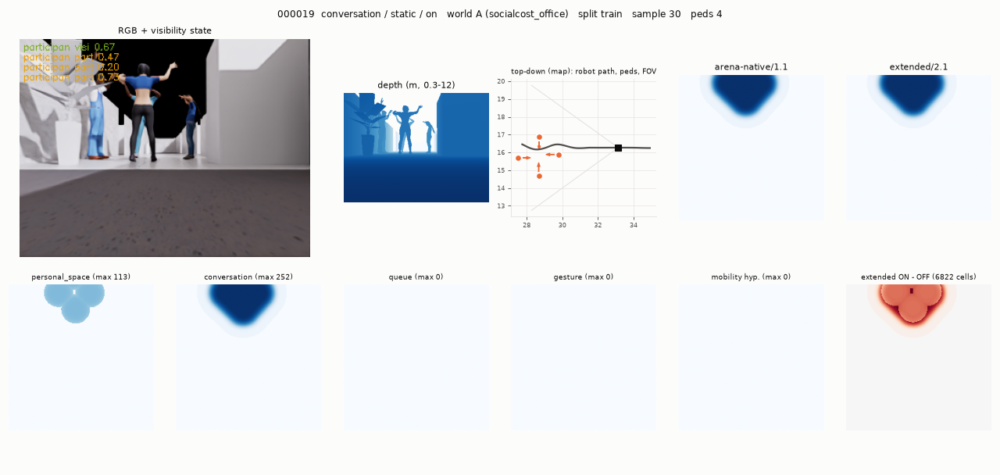
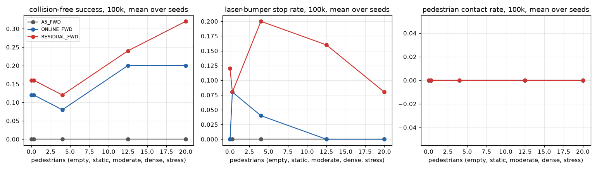

# arena_socialcost

Research code and reports built on [Arena-Rosnav](https://github.com/Arena-Rosnav) (ROS 2 Jazzy, Isaac Sim 6.1, MuJoCo, humansim):

| Project | Status | Folder |
|---|---|---|
| **SOCIALCOST**: counterfactual social costmaps from RGB-D under partial observability (dataset_v1 and navigation challenge) | ongoing | [`socialcost/`](socialcost/) |
| **Mean-field crowd navigation**: PPO navigation with a crowd-density forecast channel | previous work, partial results | [`mean_field_crowd/`](mean_field_crowd/) |

This repository holds code, configs, scenario definitions, reports and small result files. The recordings (dataset_v1 is about 38 GB), checkpoints and traces stay on the workstation. The changes to Arena itself are shipped as patches against the recorded base commits.

---

## 1. SOCIALCOST dataset_v1

*One sample of a counterfactual pair (episode 000019, conversation ON, world A). Top row: RGB with per-person visibility state, depth, top-down scene (robot path, people, camera FOV), arena-native/1.1 and extended/2.1 costmaps. Bottom row: the cost components (personal space, conversation, queue, gesture, mobility hypothesis) and the extended-label difference to the OFF twin. The OFF twin has the same people, poses, bodies and robot route but no interaction.*

### Goal

A paired benchmark in which social semantics, visibility, appearance and navigation consequences vary independently:

- **RQ1:** can RGB-D tell apart socially different situations when pedestrian positions and headings are identical?
- **RQ2:** can social costmaps be estimated when people are occluded, leave the camera FOV or come back into it?
- **RQ3:** do predicted social costmaps help when the robot must choose between geometrically valid but socially different routes?

### Design (frozen manifest, sha256 `f47fe207…`)

| Item | Value |
|---|---|
| Episodes | 600, 25 s at 5 Hz (125 samples each), Isaac Sim 6.1, TurtleBot4 with OAK-D (320 × 240 RGB-D), bodies-only Nav2 |
| Families | conversation 120, stop gesture 100, wheelchair 100, queue 100 (all ON/OFF pairs), group walking 60, partial observability 80, controls 40 |
| Worlds | A `socialcost_office` (new, corridor 3 / 4 / 3 / 2.2 m with junctions), B `hospital_1`, C `airport` (open hall), D `reception` (held-out, test_b only) |
| Splits | train 360, val 60, test_a 60 (in-distribution), test_b 60 (unseen world), test_c 60 (unseen bodies); Test D = 63 counterfactual pairs inside the test splits |
| Bodies | 104 audited in the asset bucket; pool of 44 identities, 33 known and 11 held out (25 %), stratified so no gender / age / ethnicity / role / domain value is exclusive to the held-out set |
| Labels | arena-native/1.1 and extended-membership/1.1 unchanged; extended/2.1 = membership + halt gesture; per-sample components (personal space, interaction, queue, gesture, mobility hypothesis kept separate, body occupancy); max composition, checked to reproduce the native label exactly |
| Visibility labels | per pedestrian and sample: visible / partially occluded / fully occluded / outside FOV, visibility fraction, pixel estimate, time since last seen (camera projection plus depth consistency) |
| Background people | LISN-style motion (`tvss_nav`): pacing, map-routed traversals and patrol loops around the controlled social scene |

Full specification: [`socialcost/reports/dataset_v1_specification.md`](socialcost/reports/dataset_v1_specification.md).

### Results so far

| Stage | Result |
|---|---|
| A: audit, manifest, 16-episode subset | passed (16/16 episodes, 6/6 pairs) after fixing the World A swap (office_1 tipped the robot and took 405 s per launch), queue targeting (humansim resolves desks by type) and out-of-view placement in open halls |
| B: 120-episode pilot | 120/120 episodes and 42/42 pairs pass every check; 32 pairs visually observable, 10 hidden-state (queues) |
| C: remaining 480 | 478 recorded (15.5 h); 164/167 pairs pass. Open items below |
| Collection speed | about 93 s per episode with one Isaac launch per world group (was about 175 s with a relaunch per episode). The run is GPU-bound on rendering; rendering every second physics step was tried and rejected because it broke RGB/depth pairing |

Counterfactual quality:
- Controlled people (participants, gesturers, wheelchair users, queue members) agree within 2 cm / 2 deg between ON and OFF until the robot passes within 1 m of them.
- Robot and background trajectories are not forced: background people react to the robot. The robot path differs between conditions by 0.29 m (median per pair).

Open items (in progress):
- Approach-and-stop conversations: 3 of 15 pairs never started talking, because simultaneous symmetric seeks created two one-person interactions. The scenario compiler now staggers the seek, and all 15 pairs are being re-recorded.
- One pair (000117/000118) failed three attempts and is being re-recorded.
- 13 of 80 partial-observability episodes did not show their designed event. They are kept, with an `achieved_visibility_category` (67 met; 7 re-entry designs achieved FOV exit, 3 never visible, 2 visible throughout, 1 occlusion only).
- Seven stop-gesture pairs are labelled not visually observable: the hand is raised once the person is near the robot and leaving the image.
- The 36 navigation challenge configurations are generated and pass the offline route test (shortest route crosses the social region, the detour is 2–60 % longer, a social-cost planner takes the detour). Their robot-free pedestrian reference runs are being recorded.

Reports: [specification](socialcost/reports/dataset_v1_specification.md), [pilot validation](socialcost/results/validation_pilot/validation.md), [subset validation](socialcost/results/validation_subset/validation.md), [earlier phase-1 reproducibility](socialcost/reports/reproducibility.md).

### Layout

| Path | Contents |
|---|---|
| `socialcost/package/` | ROS 2 package `socialcost`: recorder, offline label painter over the Arena layer's `cost_math.hpp`, QA. `socialcost/dv1/` holds the dataset_v1 spec, geometry, scene builders, scenario compiler and post-processing |
| `socialcost/package/scripts/dv1_*.py` | manifest, scenarios, assets audit, collection (persistent mode), validation, visualization, achieved visibility, navigation challenge and references, reports, freeze |
| `socialcost/scripts/` | detached runners (`run_dv1.sh <subset\|pilot\|remaining\|all>`) |
| `socialcost/arena/worlds/socialcost_office/` | World A (copy into `arena_simulation_setup/worlds/`, then `colcon build --packages-select arena_simulation_setup`) |
| `socialcost/arena/patches/` | opt-in render decimation flag for `arena_isaac/run_isaacsim.py` (off unless `/opt/arena_ws/log/isaac_render_every` exists) |
| `socialcost/dataset_v1/` | frozen manifest, splits, body pools, asset manifest, achieved visibility |
| `socialcost/navigation_challenge_v1/` | 36 challenge configs with route figures |

---

## 2. Mean-field crowd navigation (previous work)

*Matched test set, 100k steps, seed 5 (partial). Collision-free success, laser-bumper stops and pedestrian contacts against crowd size for AGENT_5 without a forecast, AGENT_MF_ONLINE (constant-velocity crowd density forecast) and AGENT_MF_RESIDUAL (online forecast plus a frozen 211-parameter interaction residual).*

A 16 × 16 crowd-density forecast, conditioned on the executed command and looking 1 s ahead, is added as a sixth ResNet channel to the AGENT_5 PPO policy. Everything else is identical across arms: PPO settings, reward, normalized action space, scenario mixture and seeds.

- **Forecasting:** on 75 held-out PedVO episodes the online constant-velocity forecast cuts MSE about 3× against persistence. The residual model matches it overall (Δ +0.012 × 10⁻³, CI [−0.040, +0.068]) and is slightly better near the robot (within 3 m: −0.029, CI [−0.055, −0.006]).
- **Navigation (seed 5 only, partial):** both forecast arms beat the forecast-free baseline on collision-free success in every random-crowd scenario (dense: online +0.20, residual +0.24). Caveat: the baseline arm barely moved in this run (forward speed about 0 m/s, timing out in almost every episode), so these deltas measure a failed baseline more than the forecast. Head-on and crossing episodes stayed at 0 % success for all arms. More seeds are needed before any conclusion.
- An earlier 20k-step reward study (`nav/`) found that tracking the final goal raised training goal counts but gave 0/50 goals in the matched evaluation.

Reports: [`mean_field_crowd/bench/results/REPORT.md`](mean_field_crowd/bench/results/REPORT.md), [`mean_field_crowd/bench/README.md`](mean_field_crowd/bench/README.md), [`mean_field_crowd/nav/`](mean_field_crowd/nav/).

### Layout

| Path | Contents |
|---|---|
| `mean_field_crowd/rosnav_rl/` | `rosnav_rl_modified.diff` (changes to tracked files) and `new_files/` (mean-field feature extractors, density / pedestrian spaces, `mean_field_ppo.py`, tests) against `BASE_COMMIT` |
| `mean_field_crowd/arena_training_patch/` | mixture curriculum, action-stats callback and trainer wiring |
| `mean_field_crowd/configs/` | training yamls (AGENT_5, AGENT_MF_*, diagnostics) |
| `mean_field_crowd/bench/` | benchmark pipeline, stages, report generator, results and plots |
| `mean_field_crowd/pedvo/` | PedVO data-collection outputs and the frozen interaction residual |
| `mean_field_crowd/analysis/` | diagnostics scripts and their JSON outputs |

---

Recordings, checkpoints and run logs are not in the repository. The workstation layout and commands are described in each report.
