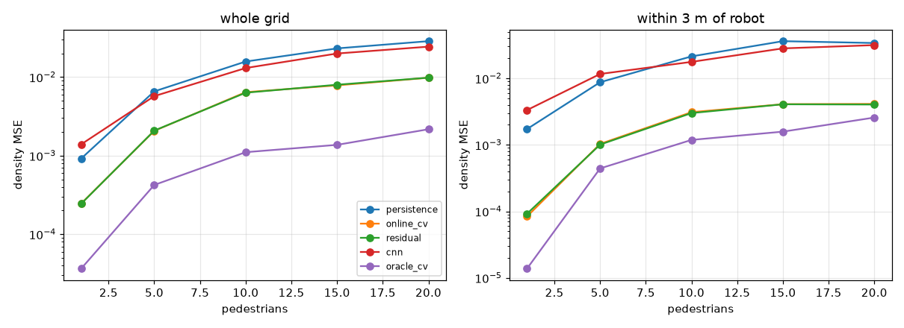
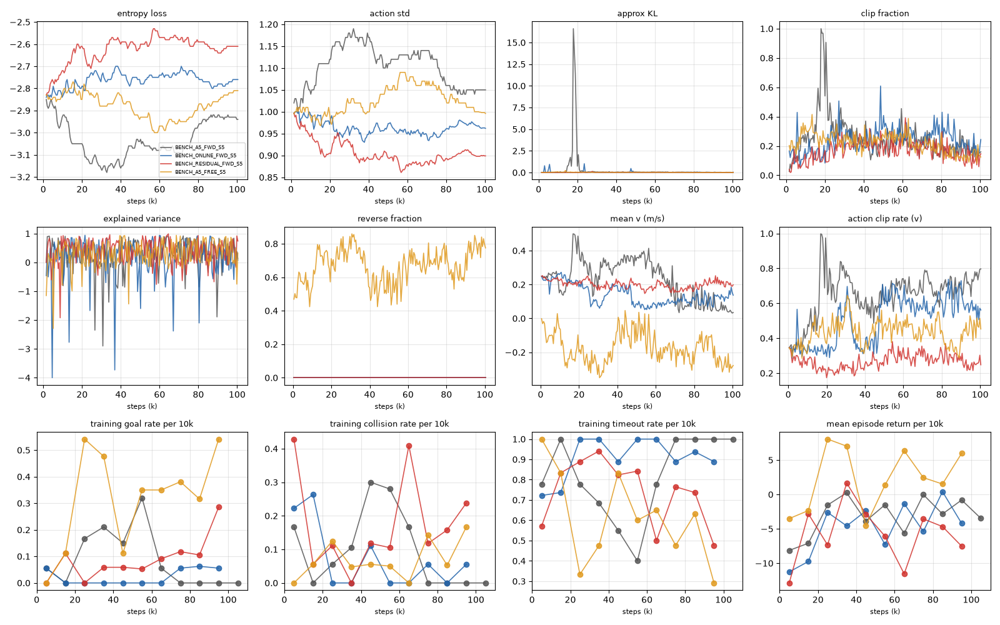
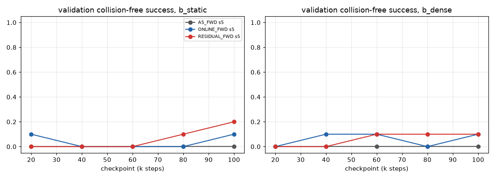
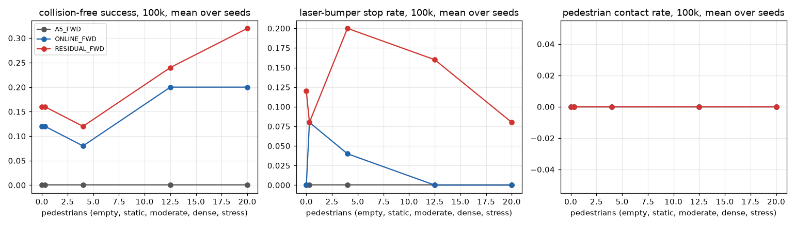

# Mean-field navigation benchmark — PARTIAL report

Generated 2026-10-29 12:20 UTC. Expected seeds: [5]. Completed runs: BENCH_A5_FWD_S5, BENCH_ONLINE_FWD_S5, BENCH_RESIDUAL_FWD_S5. Forecasting: done.

> **Partial results.** Runs and evaluations still in progress are missing from the tables; nothing here is a final conclusion.

## Phase 1: forecasting benchmark

Held-out closed-loop PedVO rollouts (run seeds `bench-fc-*`, never used for training the residual or for navigation evaluation). Density 16×16, ROI 20 m, σ 0.5 m, horizon 1 s. Lower is better. CIs are paired bootstrap over episodes.

**MSE ×1e3, all pairs, whole grid**

| Scenario | Episodes | Pairs | persistence | online_cv | residual | cnn | oracle_cv | Residual − Online CV (95% CI) |
|---|--:|--:|--:|--:|--:|--:|--:|---|
| ALL | 75 | 17115 | 12.360 | 4.231 | 4.243 | 10.621 | 0.837 | +0.012 [-0.040, +0.068] |
| fc_crossing | 5 | 871 | 2.739 | 0.275 | 0.268 | 1.666 | 0.089 | -0.008 [-0.009, -0.005] |
| fc_headon | 5 | 919 | 2.195 | 0.280 | 0.264 | 1.163 | 0.171 | -0.016 [-0.026, -0.005] |
| fc_n1 | 10 | 2215 | 0.918 | 0.245 | 0.244 | 1.392 | 0.036 | -0.001 [-0.011, +0.013] |
| fc_n10 | 10 | 2355 | 15.758 | 6.419 | 6.320 | 13.025 | 1.106 | -0.099 [-0.268, +0.043] |
| fc_n10_static | 10 | 2300 | 12.708 | 4.365 | 4.363 | 11.417 | 0.866 | -0.002 [-0.101, +0.092] |
| fc_n15 | 10 | 2203 | 23.163 | 7.839 | 7.988 | 19.936 | 1.372 | +0.149 [-0.077, +0.409] |
| fc_n20 | 10 | 2453 | 28.622 | 9.800 | 9.820 | 24.373 | 2.166 | +0.020 [-0.192, +0.191] |
| fc_n5 | 10 | 2252 | 6.573 | 2.067 | 2.082 | 5.717 | 0.424 | +0.015 [-0.060, +0.105] |
| fc_parallel | 5 | 1547 | 1.762 | 0.170 | 0.202 | 1.721 | 0.078 | +0.032 [+0.028, +0.041] |

**MSE ×1e3, all pairs, cells within 2 m of the robot**

| Scenario | Episodes | Pairs | persistence | online_cv | residual | cnn | oracle_cv | Residual − Online CV (95% CI) |
|---|--:|--:|--:|--:|--:|--:|--:|---|
| ALL | 75 | 17115 | 17.395 | 1.462 | 1.453 | 15.720 | 1.007 | -0.010 [-0.031, +0.010] |
| fc_crossing | 5 | 871 | 18.060 | 0.403 | 0.399 | 9.763 | 0.002 | -0.004 [-0.006, -0.003] |
| fc_headon | 5 | 919 | 9.603 | 0.608 | 0.551 | 2.049 | 0.493 | -0.057 [-0.061, -0.054] |
| fc_n1 | 10 | 2215 | 1.538 | 0.031 | 0.038 | 2.739 | 0.017 | +0.006 [-0.002, +0.020] |
| fc_n10 | 10 | 2355 | 22.075 | 1.752 | 1.684 | 18.581 | 0.959 | -0.068 [-0.135, -0.017] |
| fc_n10_static | 10 | 2300 | 17.808 | 2.042 | 2.052 | 19.911 | 1.693 | +0.010 [-0.026, +0.045] |
| fc_n15 | 10 | 2203 | 32.877 | 2.430 | 2.414 | 27.835 | 1.539 | -0.017 [-0.060, +0.040] |
| fc_n20 | 10 | 2453 | 32.687 | 3.156 | 3.165 | 28.371 | 2.440 | +0.009 [-0.127, +0.096] |
| fc_n5 | 10 | 2252 | 6.526 | 0.680 | 0.687 | 10.127 | 0.462 | +0.007 [-0.015, +0.039] |
| fc_parallel | 5 | 1547 | 6.140 | 0.386 | 0.395 | 6.030 | 0.108 | +0.009 [-0.001, +0.015] |

**MSE ×1e3, all pairs, cells within 3 m**

| Scenario | Episodes | Pairs | persistence | online_cv | residual | cnn | oracle_cv | Residual − Online CV (95% CI) |
|---|--:|--:|--:|--:|--:|--:|--:|---|
| ALL | 75 | 17115 | 17.924 | 2.088 | 2.059 | 16.084 | 0.987 | -0.029 [-0.055, -0.006] |
| fc_crossing | 5 | 871 | 11.057 | 0.662 | 0.650 | 5.638 | 0.001 | -0.011 [-0.019, +0.002] |
| fc_headon | 5 | 919 | 8.672 | 0.341 | 0.326 | 1.789 | 0.271 | -0.015 [-0.016, -0.014] |
| fc_n1 | 10 | 2215 | 1.725 | 0.084 | 0.092 | 3.328 | 0.014 | +0.008 [-0.022, +0.037] |
| fc_n10 | 10 | 2355 | 21.359 | 3.099 | 3.003 | 17.662 | 1.186 | -0.096 [-0.179, -0.024] |
| fc_n10_static | 10 | 2300 | 19.295 | 2.232 | 2.248 | 20.099 | 1.276 | +0.016 [-0.029, +0.069] |
| fc_n15 | 10 | 2203 | 36.166 | 4.080 | 4.070 | 28.173 | 1.579 | -0.011 [-0.069, +0.061] |
| fc_n20 | 10 | 2453 | 33.931 | 4.125 | 4.038 | 31.543 | 2.572 | -0.087 [-0.213, +0.011] |
| fc_n5 | 10 | 2252 | 8.731 | 1.033 | 1.008 | 11.620 | 0.442 | -0.025 [-0.053, -0.001] |
| fc_parallel | 5 | 1547 | 5.238 | 0.516 | 0.508 | 5.117 | 0.063 | -0.008 [-0.012, -0.005] |

**Active pedestrian avoidance** (a pedestrian within 3 m whose true 1 s displacement deviates > 0.3 m laterally from constant velocity), MSE ×1e3

| Scenario | Active pairs | persistence | online_cv | residual | cnn | oracle_cv | Residual − Online CV (95% CI) |
|---|--:|--:|--:|--:|--:|--:|---|
| ALL | 706 | 23.849 | 9.048 | 9.192 | 20.120 | 3.998 | +0.144 [-0.125, +0.384] |
| fc_n1 | 1 | 1.969 | 1.676 | 1.662 | 0.057 | 1.680 | -0.014 [-0.014, -0.014] |
| fc_n10 | 91 | 18.137 | 7.215 | 7.255 | 15.337 | 2.595 | +0.039 [-0.759, +0.713] |
| fc_n10_static | 114 | 15.641 | 7.581 | 7.452 | 15.453 | 3.593 | -0.129 [-0.600, +0.082] |
| fc_n15 | 136 | 27.326 | 10.909 | 10.947 | 22.531 | 4.984 | +0.039 [-0.164, +0.201] |
| fc_n20 | 307 | 29.927 | 10.110 | 10.422 | 24.516 | 4.382 | +0.312 [-0.258, +0.713] |
| fc_n5 | 57 | 8.731 | 4.880 | 5.081 | 8.018 | 2.667 | +0.201 [-0.144, +0.846] |

**Forecast latency per call (batch 1, ms)**: cpu/n1/online_cv_ms 0.17, cpu/n1/residual_ms 0.56, cpu/n10/online_cv_ms 0.19, cpu/n10/residual_ms 0.70, cpu/n20/online_cv_ms 0.21, cpu/n20/residual_ms 0.78, cuda/n1/online_cv_ms 0.64, cuda/n1/residual_ms 4.59, cuda/n10/online_cv_ms 0.52, cuda/n10/residual_ms 4.59, cuda/n20/online_cv_ms 0.53, cuda/n20/residual_ms 4.57

## Phase 3: training curves

Training episodes are not a matched evaluation; they show learning dynamics only.

| Run | Episodes | Goal | Collision | Timeout | Mixture stages started (empty/static/moderate/dense) | Last fps | GPU MiB |
|---|--:|--:|--:|--:|---|--:|--:|
| BENCH_A5_FWD_S5 | 186 | 20 | 22 | 144 | 42/50/69/25 | 11 | 2290 |
| BENCH_ONLINE_FWD_S5 | 173 | 4 | 13 | 156 | 40/42/67/24 | 14 | 2290 |
| BENCH_RESIDUAL_FWD_S5 | 189 | 17 | 35 | 137 | 43/49/70/27 | 14 | 2290 |
| BENCH_A5_FREE_S5 | 201 | 68 | 15 | 118 | 45/53/73/30 | 14 | 2290 |

## Phase 4: matched navigation evaluation

**Test set** (run seeds `bench-test-*`; 25 episodes on random scenarios, 10 on head-on/crossing). Rates are fractions of episodes.

| Arm | Seed | Ckpt | Scenario | N | cf_goal | goal | static_collision | ped_contact | laser_bumper | timeout | ped_clearance | safety_violation | reverse_frac | forward_speed | time_to_goal | path_efficiency | progress |
|---|--:|---|---|--:|--:|--:|--:|--:|--:|--:|--:|--:|--:|--:|--:|--:|--:|
| A5_FWD | 5 | t100000 | b_empty | 25 | 0.00 | 0.00 | 0.00 | 0.00 | 0.00 | 1.00 | – | 0.00 | 0.00 | 0.00 | – | – | 0.00 |
| ONLINE_FWD | 5 | t100000 | b_empty | 25 | 0.12 | 0.12 | 0.04 | 0.00 | 0.00 | 0.84 | – | 0.01 | 0.00 | 0.22 | 35.30 | 0.54 | 0.53 |
| RESIDUAL_FWD | 5 | t100000 | b_empty | 25 | 0.16 | 0.16 | 0.04 | 0.00 | 0.12 | 0.68 | – | 0.02 | 0.00 | 0.19 | 31.07 | 0.79 | 0.54 |
| A5_FWD | 5 | t100000 | b_static | 25 | 0.00 | 0.00 | 0.00 | 0.00 | 0.00 | 1.00 | – | 0.00 | 0.00 | 0.00 | – | – | 0.00 |
| ONLINE_FWD | 5 | t100000 | b_static | 25 | 0.12 | 0.12 | 0.08 | 0.00 | 0.08 | 0.76 | – | 0.05 | 0.00 | 0.24 | 36.43 | 0.55 | 0.54 |
| RESIDUAL_FWD | 5 | t100000 | b_static | 25 | 0.16 | 0.16 | 0.04 | 0.00 | 0.08 | 0.72 | – | 0.04 | 0.00 | 0.18 | 29.10 | 0.85 | 0.51 |
| A5_FWD | 5 | t100000 | b_moderate | 25 | 0.00 | 0.00 | 0.00 | 0.00 | 0.00 | 1.00 | 1.66 | 0.04 | 0.00 | 0.00 | – | – | 0.00 |
| ONLINE_FWD | 5 | t100000 | b_moderate | 25 | 0.08 | 0.08 | 0.00 | 0.00 | 0.04 | 0.88 | 1.10 | 0.05 | 0.00 | 0.19 | 36.60 | 0.64 | 0.52 |
| RESIDUAL_FWD | 5 | t100000 | b_moderate | 25 | 0.12 | 0.12 | 0.04 | 0.00 | 0.20 | 0.64 | 1.24 | 0.07 | 0.00 | 0.17 | 33.80 | 0.76 | 0.56 |
| A5_FWD | 5 | t100000 | b_dense | 25 | 0.00 | 0.00 | 0.00 | 0.00 | 0.00 | 1.00 | 0.77 | 0.05 | 0.00 | 0.00 | – | – | -0.00 |
| ONLINE_FWD | 5 | t100000 | b_dense | 25 | 0.20 | 0.20 | 0.00 | 0.00 | 0.00 | 0.80 | 0.26 | 0.11 | 0.00 | 0.15 | 48.76 | 0.56 | 0.50 |
| RESIDUAL_FWD | 5 | t100000 | b_dense | 25 | 0.24 | 0.24 | 0.00 | 0.00 | 0.16 | 0.60 | 0.55 | 0.15 | 0.00 | 0.17 | 37.47 | 0.79 | 0.50 |
| A5_FWD | 5 | t100000 | b_stress | 25 | 0.00 | 0.00 | 0.00 | 0.00 | 0.00 | 1.00 | 0.34 | 0.09 | 0.00 | 0.00 | – | – | -0.00 |
| ONLINE_FWD | 5 | t100000 | b_stress | 25 | 0.20 | 0.20 | 0.08 | 0.00 | 0.00 | 0.72 | 0.12 | 0.21 | 0.00 | 0.14 | 44.00 | 0.66 | 0.52 |
| RESIDUAL_FWD | 5 | t100000 | b_stress | 25 | 0.32 | 0.32 | 0.04 | 0.00 | 0.08 | 0.56 | 0.30 | 0.21 | 0.00 | 0.16 | 41.58 | 0.83 | 0.57 |
| A5_FWD | 5 | t100000 | b_headon | 10 | 0.00 | 0.00 | 0.00 | 0.00 | 0.00 | 1.00 | 0.08 | 0.24 | 0.00 | 0.00 | – | – | 0.01 |
| ONLINE_FWD | 5 | t100000 | b_headon | 10 | 0.00 | 0.00 | 0.00 | 0.00 | 0.00 | 1.00 | 0.09 | 0.14 | 0.00 | 0.23 | – | – | 0.65 |
| RESIDUAL_FWD | 5 | t100000 | b_headon | 10 | 0.00 | 0.00 | 0.00 | 0.00 | 0.00 | 1.00 | 0.08 | 0.04 | 0.00 | 0.13 | – | – | 0.49 |
| A5_FWD | 5 | t100000 | b_crossing | 10 | 0.00 | 0.00 | 0.00 | 0.00 | 0.00 | 1.00 | 3.98 | 0.00 | 0.00 | 0.00 | – | – | 0.01 |
| ONLINE_FWD | 5 | t100000 | b_crossing | 10 | 0.00 | 0.00 | 0.00 | 0.00 | 0.00 | 1.00 | 0.29 | 0.04 | 0.00 | 0.28 | – | – | 0.77 |
| RESIDUAL_FWD | 5 | t100000 | b_crossing | 10 | 0.00 | 0.00 | 0.00 | 0.00 | 0.00 | 1.00 | 0.09 | 0.05 | 0.00 | 0.14 | – | – | 0.48 |

**Paired comparisons** (same episodes; Δ = A − B with 95% paired-bootstrap CI, pooled over available seeds; per-seed deltas give seed variability)

| A − B | Ckpt | Scenario | Seeds | Δ collision-free success | Δ laser bumper | Δ ped contact | Δ timeout | Δ ped clearance (m) | per-seed Δ cf_goal |
|---|---|---|---|---|---|---|---|---|---|
| ONLINE_FWD − A5_FWD | t100000 | b_crossing | 5 | +0.000 [+0.000, +0.000] | +0.000 [+0.000, +0.000] | +0.000 [+0.000, +0.000] | +0.000 [+0.000, +0.000] | -3.698 [-3.930, -3.466] | s5:+0.00 |
| ONLINE_FWD − A5_FWD | t100000 | b_dense | 5 | +0.200 [+0.080, +0.360] | +0.000 [+0.000, +0.000] | +0.000 [+0.000, +0.000] | -0.200 [-0.360, -0.040] | -0.513 [-0.841, -0.219] | s5:+0.20 |
| ONLINE_FWD − A5_FWD | t100000 | b_empty | 5 | +0.120 [+0.000, +0.241] | +0.000 [+0.000, +0.000] | +0.000 [+0.000, +0.000] | -0.160 [-0.320, -0.040] | – | s5:+0.12 |
| ONLINE_FWD − A5_FWD | t100000 | b_headon | 5 | +0.000 [+0.000, +0.000] | +0.000 [+0.000, +0.000] | +0.000 [+0.000, +0.000] | +0.000 [+0.000, +0.000] | +0.009 [+0.001, +0.019] | s5:+0.00 |
| ONLINE_FWD − A5_FWD | t100000 | b_moderate | 5 | +0.080 [+0.000, +0.200] | +0.040 [+0.000, +0.120] | +0.000 [+0.000, +0.000] | -0.120 [-0.280, +0.000] | -0.554 [-1.051, -0.053] | s5:+0.08 |
| ONLINE_FWD − A5_FWD | t100000 | b_static | 5 | +0.120 [+0.000, +0.240] | +0.080 [+0.000, +0.200] | +0.000 [+0.000, +0.000] | -0.240 [-0.440, -0.080] | – | s5:+0.12 |
| ONLINE_FWD − A5_FWD | t100000 | b_stress | 5 | +0.200 [+0.080, +0.360] | +0.000 [+0.000, +0.000] | +0.000 [+0.000, +0.000] | -0.280 [-0.480, -0.120] | -0.218 [-0.392, -0.068] | s5:+0.20 |
| RESIDUAL_FWD − A5_FWD | t100000 | b_crossing | 5 | +0.000 [+0.000, +0.000] | +0.000 [+0.000, +0.000] | +0.000 [+0.000, +0.000] | +0.000 [+0.000, +0.000] | -3.896 [-4.048, -3.783] | s5:+0.00 |
| RESIDUAL_FWD − A5_FWD | t100000 | b_dense | 5 | +0.240 [+0.080, +0.400] | +0.160 [+0.040, +0.320] | +0.000 [+0.000, +0.000] | -0.400 [-0.600, -0.200] | -0.222 [-0.589, +0.218] | s5:+0.24 |
| RESIDUAL_FWD − A5_FWD | t100000 | b_empty | 5 | +0.160 [+0.040, +0.320] | +0.120 [+0.000, +0.280] | +0.000 [+0.000, +0.000] | -0.320 [-0.520, -0.120] | – | s5:+0.16 |
| RESIDUAL_FWD − A5_FWD | t100000 | b_headon | 5 | +0.000 [+0.000, +0.000] | +0.000 [+0.000, +0.000] | +0.000 [+0.000, +0.000] | +0.000 [+0.000, +0.000] | -0.001 [-0.003, +0.002] | s5:+0.00 |
| RESIDUAL_FWD − A5_FWD | t100000 | b_moderate | 5 | +0.120 [+0.000, +0.240] | +0.200 [+0.080, +0.360] | +0.000 [+0.000, +0.000] | -0.360 [-0.560, -0.200] | -0.418 [-1.008, +0.204] | s5:+0.12 |
| RESIDUAL_FWD − A5_FWD | t100000 | b_static | 5 | +0.160 [+0.040, +0.320] | +0.080 [+0.000, +0.200] | +0.000 [+0.000, +0.000] | -0.280 [-0.440, -0.120] | – | s5:+0.16 |
| RESIDUAL_FWD − A5_FWD | t100000 | b_stress | 5 | +0.320 [+0.160, +0.520] | +0.080 [+0.000, +0.200] | +0.000 [+0.000, +0.000] | -0.440 [-0.640, -0.240] | -0.037 [-0.310, +0.362] | s5:+0.32 |
| RESIDUAL_FWD − ONLINE_FWD | t100000 | b_crossing | 5 | +0.000 [+0.000, +0.000] | +0.000 [+0.000, +0.000] | +0.000 [+0.000, +0.000] | +0.000 [+0.000, +0.000] | -0.199 [-0.366, -0.060] | s5:+0.00 |
| RESIDUAL_FWD − ONLINE_FWD | t100000 | b_dense | 5 | +0.040 [-0.080, +0.160] | +0.160 [+0.040, +0.320] | +0.000 [+0.000, +0.000] | -0.200 [-0.400, +0.000] | +0.291 [-0.075, +0.709] | s5:+0.04 |
| RESIDUAL_FWD − ONLINE_FWD | t100000 | b_empty | 5 | +0.040 [-0.080, +0.200] | +0.120 [+0.000, +0.240] | +0.000 [+0.000, +0.000] | -0.160 [-0.360, +0.000] | – | s5:+0.04 |
| RESIDUAL_FWD − ONLINE_FWD | t100000 | b_headon | 5 | +0.000 [+0.000, +0.000] | +0.000 [+0.000, +0.000] | +0.000 [+0.000, +0.000] | +0.000 [+0.000, +0.000] | -0.009 [-0.021, -0.002] | s5:+0.00 |
| RESIDUAL_FWD − ONLINE_FWD | t100000 | b_moderate | 5 | +0.040 [+0.000, +0.120] | +0.160 [+0.040, +0.320] | +0.000 [+0.000, +0.000] | -0.240 [-0.400, -0.080] | +0.137 [-0.126, +0.400] | s5:+0.04 |
| RESIDUAL_FWD − ONLINE_FWD | t100000 | b_static | 5 | +0.040 [+0.000, +0.120] | +0.000 [-0.160, +0.160] | +0.000 [+0.000, +0.000] | -0.040 [-0.240, +0.160] | – | s5:+0.04 |
| RESIDUAL_FWD − ONLINE_FWD | t100000 | b_stress | 5 | +0.120 [+0.000, +0.280] | +0.080 [+0.000, +0.200] | +0.000 [+0.000, +0.000] | -0.160 [-0.360, +0.000] | +0.181 [-0.046, +0.519] | s5:+0.12 |

## Phase 5: forecast ablation (residual-trained policies)

Δ = metric with the substituted forecast − metric with the residual forecast, same episodes. The zero channel is an observation distribution shift and is not a clean 'no forecast' baseline.

| Seed | Ckpt | Scenario | Mode | Δ collision-free success | Δ laser bumper | Δ ped contact | Δ timeout | Δ ped clearance | Δ progress |
|---|---|---|---|---|---|---|---|---|---|
| 5 | t100000 | b_crossing | online | +0.000 [+0.000, +0.000] | +0.000 [+0.000, +0.000] | +0.000 [+0.000, +0.000] | +0.000 [+0.000, +0.000] | -0.001 [-0.004, +0.001] | -0.000 [-0.005, +0.005] |
| 5 | t100000 | b_dense | online | -0.040 [-0.120, +0.000] | +0.040 [+0.000, +0.120] | +0.000 [+0.000, +0.000] | +0.000 [+0.000, +0.000] | +0.058 [+0.017, +0.107] | +0.002 [-0.002, +0.007] |
| 5 | t100000 | b_headon | online | +0.000 [+0.000, +0.000] | +0.000 [+0.000, +0.000] | +0.000 [+0.000, +0.000] | +0.000 [+0.000, +0.000] | -0.001 [-0.003, +0.000] | -0.000 [-0.002, +0.002] |
| 5 | t100000 | b_moderate | online | +0.000 [+0.000, +0.000] | +0.040 [+0.000, +0.120] | +0.000 [+0.000, +0.000] | +0.000 [+0.000, +0.000] | +0.026 [-0.032, +0.113] | +0.001 [-0.006, +0.007] |
| 5 | t100000 | b_stress | online | +0.000 [+0.000, +0.000] | +0.040 [+0.000, +0.120] | +0.000 [+0.000, +0.000] | +0.000 [+0.000, +0.000] | +0.001 [-0.025, +0.026] | +0.001 [-0.001, +0.004] |
| 5 | t100000 | b_crossing | zero | +0.000 [+0.000, +0.000] | +0.000 [+0.000, +0.000] | +0.000 [+0.000, +0.000] | +0.000 [+0.000, +0.000] | +0.071 [+0.029, +0.122] | +0.026 [+0.021, +0.031] |
| 5 | t100000 | b_dense | zero | -0.040 [-0.120, +0.000] | +0.040 [-0.080, +0.160] | +0.000 [+0.000, +0.000] | -0.040 [-0.120, +0.000] | +0.025 [-0.172, +0.188] | -0.008 [-0.027, +0.009] |
| 5 | t100000 | b_headon | zero | +0.000 [+0.000, +0.000] | +0.000 [+0.000, +0.000] | +0.000 [+0.000, +0.000] | +0.000 [+0.000, +0.000] | -0.001 [-0.004, +0.001] | +0.007 [+0.005, +0.008] |
| 5 | t100000 | b_moderate | zero | +0.000 [+0.000, +0.000] | -0.080 [-0.200, +0.000] | +0.000 [+0.000, +0.000] | +0.080 [+0.000, +0.200] | -0.011 [-0.065, +0.043] | -0.008 [-0.016, +0.000] |
| 5 | t100000 | b_stress | zero | +0.000 [+0.000, +0.000] | -0.040 [-0.120, +0.000] | +0.000 [+0.000, +0.000] | +0.000 [+0.000, +0.000] | -0.013 [-0.048, +0.020] | +0.016 [+0.006, +0.029] |

## Failure analysis

Episodes no evaluated policy solved (≥3 policy evaluations, candidate impossible or very hard layouts): b_crossing: [0, 1, 2, 3, 4, 5, 6, 7, 8, 9], b_dense: [0, 1, 2, 3, 4, 6, 7, 8, 9, 10, 11, 14, 17, 18, 19, 21, 22, 24], b_empty: [0, 1, 2, 3, 6, 7, 8, 9, 10, 11, 12, 13, 14, 15, 16, 17, 18, 19, 20, 22], b_headon: [0, 1, 2, 3, 4, 5, 6, 7, 8, 9], b_moderate: [0, 1, 2, 3, 4, 6, 7, 8, 9, 10, 11, 12, 13, 14, 15, 17, 18, 19, 20, 22, 23, 24], b_static: [0, 1, 3, 4, 5, 6, 7, 8, 9, 10, 12, 13, 14, 15, 16, 17, 19, 20, 22, 23, 24], b_stress: [2, 3, 4, 5, 8, 11, 12, 13, 14, 15, 16, 17, 19, 21, 22, 23, 24]

